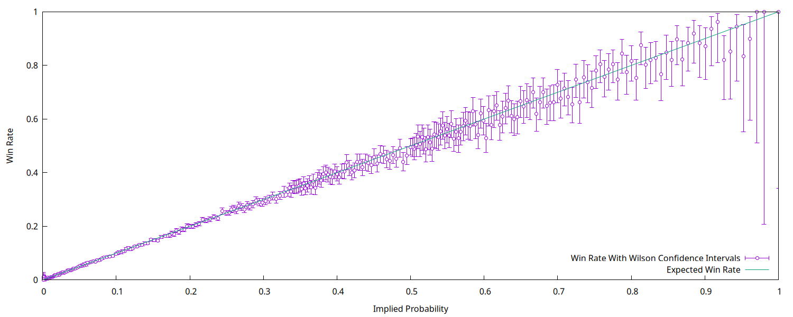
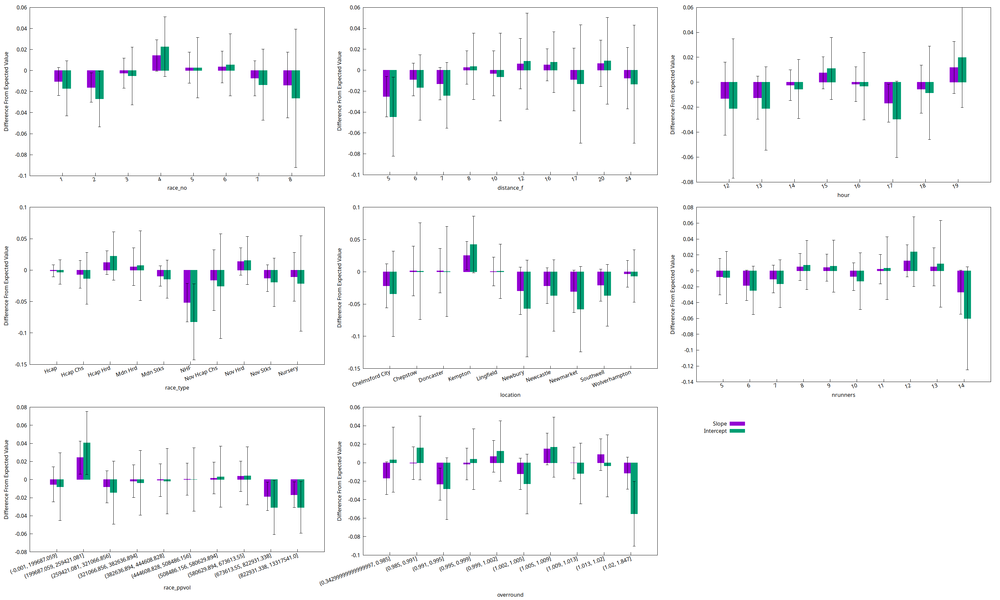
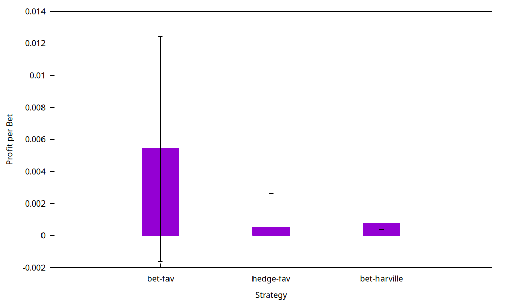

# Accuracy and Efficiency of Horse Racing Betting Markets

**MSc Computational Finance dissertation, King's College London (2026)** · Matthew Abel

Is the Betfair Exchange an accurate forecaster of horse races, and can it be beaten? This project analyses **over 170,000 UK races (2008 onwards)** of Betfair Starting Price (BSP) data. It splits the market into eight categories of race to see which factors drive accuracy and efficiency.

Unlike most prior research, which studies pari-mutuel (pool) markets, this looks at an exchange: a continuous double auction where bettors trade directly with each other.

**[Read the full report (PDF)](report/report.pdf)**



## Key findings

- **The market is well calibrated, with no favourite-longshot bias.**
  - Horses win at almost exactly the rate their odds imply.
  - A logistic regression of outcomes on implied probabilities gives a slope of **0.997** (95% CI 0.991–1.002) and an intercept of **−0.006** (95% CI −0.017–0.004). Both are indistinguishable from perfect calibration.
  - Across 76 sub-groups, the few deviations are about what you'd expect from chance.
  - Most studies of US pari-mutuel markets find the opposite: favourites are underpriced and longshots overpriced.
- **It beats random forecasting.** Across all races, the Brier score is **0.0946** and the log-loss is **0.3157**. Both skill scores show the market does better than random guesses.
- **Number of runners matters most.** Of the eight categories, the number of runners shows the widest range of skill scores. Trading volume, by contrast, is not a reliable sign of accuracy: it correlates positively with skill scores in some categories and negatively in others.
- **Efficiency: mostly yes, with one caveat.**
  - Backing every favourite, or staking the inverse of its price ("hedging"), gives returns not significantly different from zero, across all races and in every category.
  - A place-betting strategy adapted from Hausch et al. (1981) earns a profit per bet significantly above zero across the whole dataset. This is a theoretical inefficiency: it assumes unlimited liquidity at the starting price and ignores the market impact of large bets.
  - No individual category shows a significant profit.



## Method

1. **Data.** Betfair's free daily archive of starting prices and traded volumes for UK win and place markets, from September 2008. A scraped Hong Kong Jockey Club dataset was also built for comparison but set aside, as it covered only about 2,000 races.
2. **Categories.** Each race is grouped by six external factors and two internal market factors:
   - external: race number, distance, hour of day, race type, course and number of runners;
   - internal: pre-race traded volume and overround.
3. **Accuracy.**
   - Win rate against implied probability, with Wilson confidence intervals.
   - Logistic calibration regressions, for all races and for each group.
   - Brier and log-loss skill scores, computed per race and averaged, with bootstrapped confidence intervals.
4. **Efficiency.** Three betting strategies are backtested across all races and within each category: back the favourite, hedge on the favourite, and an adapted Hausch et al. place-betting strategy. Mean profit per bet and its 95% confidence interval are estimated by bootstrap resampling.



## Repository layout

```
notebooks/
  01_download_betfair_sp.ipynb      download the daily BSP files from Betfair's archive
  02_build_uk_dataset.ipynb         clean and normalise them into events / races / runners tables
  03_scrape_hkjc_dataset.ipynb      scrape the Hong Kong Jockey Club comparison dataset
  04_accuracy_and_efficiency.ipynb  calibration, skill scores and strategy backtests
figures/
  make_figures.gp                   draws every figure in the report from results/tables
results/
  tables/                           CSV outputs of notebook 04
  figures/                          figures (.ps for the report, .png for this page)
report/
  report.ms, macros.ms, bib         report source (groff -ms, with refer for citations)
  compile.sh                        builds the PDF
  report.pdf                        the final report
data/                               raw and processed data (not committed; created by notebooks 01–03)
```

### Pipeline

```
01 download ──► 02 build dataset ──► 04 analysis ──► results/tables ──► make_figures.gp ──► report
03 HKJC scrape (comparison dataset, optional)
```

## Reproducing the results

**Requirements:** Python 3.10+ with the packages in `requirements.txt`. For the figures and the report you also need [gnuplot](http://www.gnuplot.info/), groff and Ghostscript.

```bash
pip install -r requirements.txt

# 1. Get and prepare the data (the download takes a while: one win and one place file per day since 2008)
jupyter nbconvert --to notebook --execute --inplace notebooks/01_download_betfair_sp.ipynb
jupyter nbconvert --to notebook --execute --inplace notebooks/02_build_uk_dataset.ipynb

# 2. Run the analysis
jupyter nbconvert --to notebook --execute --inplace notebooks/04_accuracy_and_efficiency.ipynb

# 3. Draw the figures (EPS for the report; add -e "fmt='png'" for PNGs)
gnuplot figures/make_figures.gp

# 4. Build the report
cd report && ./compile.sh report.ms
```

The raw data is not included in this repository. It comes from Betfair's publicly available [BSP price archive](https://promo.betfair.com/betfairsp/prices/), and notebook 01 downloads it.

## Built with

Python (pandas, NumPy, statsmodels, matplotlib, Requests, Beautiful Soup) · Jupyter · gnuplot · groff
